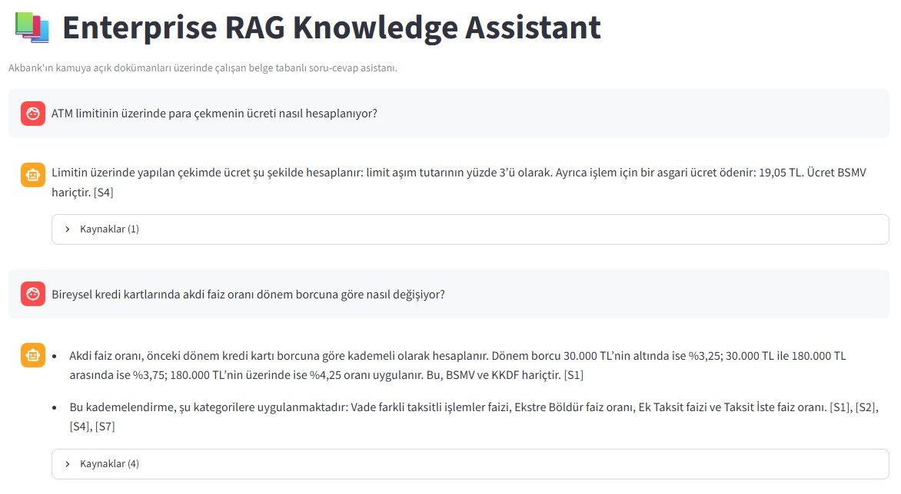
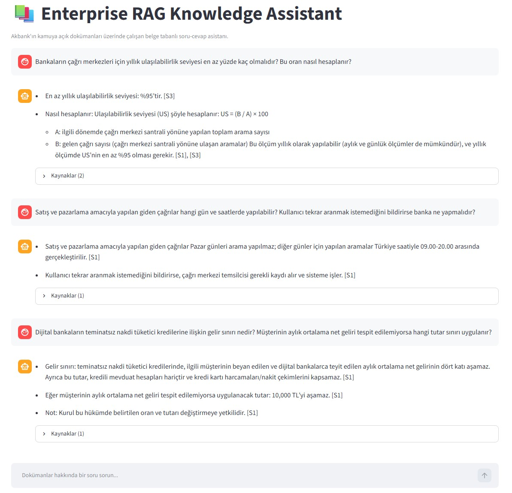
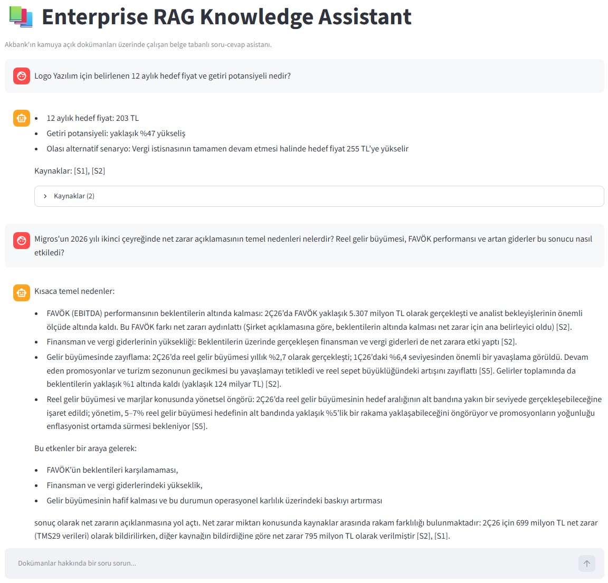

# Enterprise RAG Knowledge Assistant

A modular Retrieval-Augmented Generation (RAG) application for asking questions about public banking documents and company research reports. The application combines document ingestion, hybrid retrieval, an LLM-based answer-generation workflow, a REST API, and a Streamlit chat interface.

> **Project status:** Core RAG workflow, retrieval strategy comparison, FastAPI endpoint, and Streamlit UI are implemented. This is a portfolio/demo project, not an official Akbank service.

## Features

- Ingest PDF and JSONL documents while preserving source metadata.
- Split content into overlapping chunks and index it in Chroma.
- Retrieve relevant chunks using:
  - **Dense retrieval** with multilingual sentence embeddings.
  - **BM25** lexical retrieval.
  - **Hybrid retrieval** combining dense and BM25 rankings with Reciprocal Rank Fusion (RRF).
- Generate document-grounded answers through a LangGraph workflow.
- Return answer and source metadata through FastAPI.
- Ask questions through a Streamlit chat UI and inspect the cited source chunks.
- Configure the LLM provider centrally: Ollama, OpenAI, or Azure OpenAI.


## Demo screenshots

The screenshots below show example questions answered from three document categories currently supported by the demo. Financial reports are intentionally excluded for now because many of their key facts are presented in tables and graphics that the current text-based ingestion pipeline does not reliably process.

### Banking products

Example questions about ATM withdrawal fees and credit-card interest rates, with retrieved source references.



### BDDK regulations

Examples covering call-center accessibility requirements, outbound sales-call rules, and digital-bank consumer-loan limits.



### Company research

Examples covering a target price for Logo Yazılım and an analysis of Migros's quarterly financial performance.




## Architecture

```text
PDF / JSONL files
       |
       v
Document ingestion and parsing
       |
       v
Chunking (size 800, overlap 120)
       |
       v
Chroma vector store <------ multilingual sentence embeddings
       |                                  |
       |                                  v
       |                           Dense retrieval
       |
       +--------------------> BM25 retrieval
                                      |
                                      v
                         Reciprocal Rank Fusion (RRF)
                                      |
                                      v
                           Top 10 retrieved chunks
                                      |
                                      v
                         LangGraph RAG workflow
                         retrieve -> generate
                                      |
                                      v
                              FastAPI /ask
                                      |
                                      v
                              Streamlit UI
```

The Streamlit application is a separate frontend process. It sends HTTP requests to FastAPI; it does not construct or invoke the RAG graph directly.

## Technology stack

| Component | Technology |
|---|---|
| Language | Python 3.13.5 |
| RAG workflow | LangChain, LangGraph |
| Vector store | Chroma |
| Embeddings | `sentence-transformers/paraphrase-multilingual-MiniLM-L12-v2` |
| Lexical retrieval | BM25 (`rank-bm25`) |
| Hybrid ranking | Reciprocal Rank Fusion (RRF) |
| API | FastAPI, Uvicorn |
| UI | Streamlit |
| LLM integration | Ollama, OpenAI, Azure OpenAI adapters |
| PDF parsing | pypdf |
| Configuration | Environment variables and python-dotenv |

The default configuration uses the Ollama provider and `gpt-oss:20b`. The provider factory also supports OpenAI and Azure OpenAI when configured.

## Repository layout

```text
.
├── assets/
│   └── screenshots/
│       ├── banking-products.jpg
│       ├── bddk-regulations.jpg
│       └── company-research.jpg
├── documents/                          # Local source corpus; files are not committed
│   ├── banking_products/
│   ├── bddk_regulations/
│   ├── company_research/
│   └── financial_reports/              # Reserved for future visual/table-aware ingestion
├── scripts/
│   └── fetch_akbank_fees.py
├── src/
│   ├── streamlit_app.py
│   └── rag_assistant/
│       ├── api.py
│       ├── ask.py
│       ├── config.py
│       ├── ingest.py
│       ├── rag_graph.py
│       ├── search_hybrid.py
│       ├── llm/
│       │   └── factory.py
│       ├── retrieval/
│       │   ├── bm25_retriever.py
│       │   └── hybrid_retriever.py
│       └── evaluation/
├── requirements.txt
└── README.md
```

The `documents/` directory is the local source corpus. Source PDFs and JSONL files are not included in the Git repository; `.gitkeep` files preserve the category directories until you add local documents. The financial-report category is listed as a future extension because the current ingestion workflow is text-oriented and does not yet reliably extract information from image-heavy financial presentations.

## Requirements

- Python 3.13.5
- Git
- Ollama installed locally if using the default local provider, with the configured model available
- Input documents in `documents/`

## Setup (Windows PowerShell)

Run these commands from the repository root.

### 1. Create a virtual environment

```powershell
py -3.13 -m venv .venv
.\.venv\Scripts\Activate.ps1
python -m pip install --upgrade pip
pip install -r requirements.txt
```

### 2. Configure the LLM provider

The application reads configuration from environment variables and `.env`. The default provider is Ollama.

For Ollama, the defaults are:

```dotenv
LLM_PROVIDER=ollama
OLLAMA_BASE_URL=http://localhost:11434
OLLAMA_MODEL=gpt-oss:20b
```

Make sure Ollama is running and the model is available:

```powershell
ollama pull gpt-oss:20b
```

If using OpenAI instead, set `LLM_PROVIDER=openai` and provide `OPENAI_API_KEY`. If using Azure OpenAI, set `LLM_PROVIDER=azure` and configure `AZURE_OPENAI_API_KEY`, `AZURE_OPENAI_ENDPOINT`, `AZURE_OPENAI_DEPLOYMENT`, and `AZURE_OPENAI_API_VERSION`.

Keep `.env` and API keys private; never commit credentials.

### 3. Add source documents

Download or collect the documents you want to use from the public sources listed below, then place them in the matching folders under `documents/`. The ingestion script recursively reads `*.pdf` and `*.jsonl` files. It does not ingest HTML, Markdown, or `.bak` files.

Use the folder categories shown in the repository layout. Keep the original filenames where practical so source metadata remains understandable. For the Akbank fee page, use the page as the source and prepare the fee data in JSONL format; `scripts/fetch_akbank_fees.py` is available as an optional helper for extracting the page into JSONL.

After adding the files, build the index using the command in the next section. The ingestion script rebuilds the configured Chroma collection each time it runs.

### Public source documents

The source documents are not bundled with this repository. Download the relevant material from the publishers' public pages and place the files in the corresponding `documents/` subfolders.

| Folder | Public source | What to collect |
|---|---|---|
| `banking_products/` | [Akbank — Ürün ve Hizmet Ücretleri](https://www.akbank.com/urun-ve-hizmet-ucretleri) | Public banking product and service fees. Prepare the extracted fee records as `akbank_fees.jsonl`. |
| `bddk_regulations/laws/` | [BDDK — Kanunlar](https://www.bddk.org.tr/Mevzuat/Liste/49) | Relevant banking and financial-sector laws as PDF files. |
| `bddk_regulations/regulations/` | [BDDK — Yönetmelikler](https://www.bddk.org.tr/Mevzuat/Liste/50) | Relevant banking regulations as PDF files. |
| `company_research/` | [Ak Yatırım — Araştırma Raporları](https://www.akyatirim.com.tr/tr/raporlarimiz/arastirma-raporlari#) | Reports listed under **“Şirket Raporları”**, saved as PDF files. |
| `financial_reports/` | [Akbank Investor Relations — Yatırımcı Bilgi Seti](https://www.akbankinvestorrelations.com/tr/yatirimcilar-icin-bilgiler/detay/Yatirimci-bilgi-seti/310/540/0) | Akbank annual reports, earnings presentations, corporate presentations, and ESG presentations as PDF files. Sort them into the relevant subfolders. |

Only PDF and JSONL files are currently ingested. The folder name is used as the top-level document category, so keep documents in the matching folder. The links above are publisher/source pages; the exact available files and page layout may change over time. Check the publishers' terms before redistributing downloaded documents, and verify time-sensitive fees and financial information against the original source.

### 4. Build the Chroma index

Set `PYTHONPATH` so Python can import the package from `src/`, then run ingestion:

```powershell
$env:PYTHONPATH = "src"
python -m rag_assistant.ingest
```

**Warning:** Running ingestion rebuilds the configured Chroma collection. Back up the index first if you need to preserve it.

The embedding model is downloaded on first use and runs on CPU with the current configuration.

### 5. Start the FastAPI server

In PowerShell terminal 1, from the repository root:

```powershell
$env:PYTHONPATH = "src"
python -m uvicorn rag_assistant.api:app --reload
```

Useful endpoints:

- Health check: `http://127.0.0.1:8000/health`
- Interactive API documentation (Swagger UI): `http://127.0.0.1:8000/docs`
- Alternative API documentation (ReDoc): `http://127.0.0.1:8000/redoc`
- Question endpoint: `POST http://127.0.0.1:8000/ask`

FastAPI automatically generates an **OpenAPI** schema from the API routes and request/response models. The `/docs` page presents that schema through **Swagger UI**, an interactive browser-based interface where you can inspect endpoints, view request and response formats, and send test requests with **Try it out**. ReDoc provides an alternative, read-oriented view of the same API schema. These pages document and help test the REST API; they are separate from the Streamlit chat interface used to ask questions conversationally.

Example request body:

```json
{
  "question": "Akbank Mobil üzerinden EFT ücreti nedir?"
}
```

### 6. Start the Streamlit UI

In PowerShell terminal 2, from the repository root:

```powershell
python -m streamlit run src/streamlit_app.py
```

Open the local URL printed by Streamlit (normally `http://localhost:8501`). The UI's default API URL is `http://127.0.0.1:8000`. Start FastAPI first and use the sidebar's API health-check button to verify connectivity.

## Retrieval strategy comparison

The project compares three retrieval strategies over a 26-question benchmark. Each strategy returns up to 10 chunks. Recall@k measures whether at least one expected relevant record appears in the top k; MRR@10 rewards retrieving the first relevant record nearer to the top.

| Strategy | Recall@1 | Recall@3 | Recall@5 | Recall@10 | MRR@10 |
|---|---:|---:|---:|---:|---:|
| Dense | 12% | 16% | 20% | 36% | 0.166 |
| BM25 | 68% | 96% | 100% | 100% | 0.821 |
| Hybrid RRF | 28% | 68% | 88% | 96% | 0.534 |

### Interpretation

- **BM25 performed best on this benchmark.** Many questions ask for exact fee names, transaction channels, monetary ranges, and specific banking terminology, which lexical retrieval can match effectively.
- **Hybrid RRF improved on dense retrieval** across the reported Recall@k values and MRR@10, but did not outperform BM25 on this dataset.
- **Dense retrieval alone was weakest on this benchmark.** This is a useful result rather than proof that dense retrieval is generally inferior: results depend on the documents, query set, chunking, embedding model, and relevance definitions.
- These are retrieval metrics, not end-to-end answer-quality scores. They do not directly measure factual correctness, citation correctness, or whether the LLM abstains appropriately.

The benchmark is a project-level diagnostic set, not a universal or definitive evaluation. Results should be interpreted in the context of its questions and relevance labels.

## API contract

### `GET /health`

Returns a lightweight process health response:

```json
{
  "status": "ok"
}
```

This endpoint does not call the LLM or verify that the vector index is populated.

### `POST /ask`

Request:

```json
{
  "question": "Akbank Mobil üzerinden EFT ücreti nedir?"
}
```

Response shape:

```json
{
  "question": "Akbank Mobil üzerinden EFT ücreti nedir?",
  "answer": "Answer text with source citations such as [S1].",
  "sources": [
    {
      "id": "S1",
      "source": "documents/banking_products/akbank_fees.jsonl",
      "page": "Unknown",
      "content": "Retrieved source chunk text"
    }
  ]
}
```

The exact source values depend on the retrieved documents. The UI filters the returned source list to display source IDs cited in the answer text (for example, `[S1]`). This is a presentation-level citation filter; it does not independently verify that a cited chunk entails the answer.
